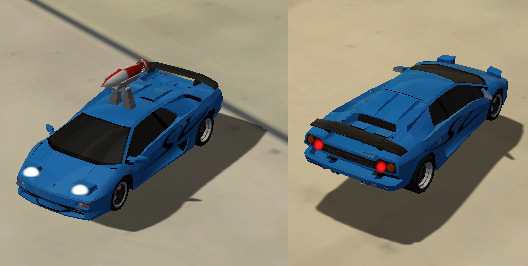

# Mad Tracks Import/Export for Blender




A Blender add-on to import and export assets from the game **Mad Tracks**, tested with Blender **3.4** and **4.3**.

| Format | Import | Export | What it is |
|---|:-:|:-:|---|
| `.ldo` | &#10003; | &#10003; | Object/model files (meshes, materials, node hierarchy) — both the original release format and the Steam release format |
| `.ini` (level) | &#10003; | &#10003; | Level layout: placed objects, plus the world mesh, skybox and AI path (not exported) from the matching `.dam` / `.gra` files |
| `.ldl` | &#10003; | &#10005; | Level lightmaps, applied optionally while importing a level |

## Installation

1. Download `io_scene_madtracks-<version>.zip` from the releases page
2. In Blender, open **Edit &#8594; Preferences &#8594; Add-ons**.
   - Blender 4.2 and newer: click the **&#8964;** menu in the top right &#8594; **Install from Disk…**
   - Blender 4.1 and older: click **Install…**
3. Select the zip and enable **Import-Export: Mad Tracks Import/Export**.

The importers and exporters then appear under **File &#8594; Import** and **File &#8594; Export**.

## Usage

### Importing objects (`.ldo`)

**File &#8594; Import &#8594; Mad Tracks object (.ldo)**. You can select several files at once.

- **Texture Path**: the folder that contains the game's textures (`.png` is tried first, then `.dds`).
  If you leave it empty, the add-on looks in `Graph/maps/High/`, relative to the game folder the `.ldo` file is in.

Each file becomes a collection named after the file, with one child collection per *atomic* (`Atomic 0`, `Atomic 1`, …).
Hierarchy nodes without a mesh become empties (for example `DUMMY_OUT`).

### Exporting objects (`.ldo`)

**File &#8594; Export &#8594; Mad Tracks object (.ldo)** exports the **active collection** (click it in the Outliner first).
The collection must be structured like an imported one:

```
MyObject              # active collection, contains no objects directly
├── Atomic 0          # one child collection per atomic, no further sub-collections
│   ├── Mesh 0        # mesh objects (and empties), parented as needed
│   └── DUMMY_OUT
└── Atomic 1
    └── ...
```

Requirements:

- Meshes must be **triangulated** (Triangulate modifier or *Face &#8594; Triangulate Faces*).
- Each mesh needs at least one material, at most **4 UV maps** and at most **1 color attribute**.
- Materials are read from the **Principled BSDF**:
  - *Base Color* &#8592; a plain color, an **Image Texture**, an **RGB** node, or a **MixRGB** node (Color1 = texture, Color2 = RGB)
  - *Roughness* &#8592; an Image Texture is exported as the reflection/specular map
  - *Emission* &#8592; exported as emissive if any rgb channel is above 0.05
- Texture names are written without their extension (`wood.png` &#8594; `wood`).
- Enable **Old version** to write the format used before the Steam release.

### Importing levels (`.ini`)

**File &#8594; Import &#8594; Mad Tracks level (.ini)**. Select a level `.ini` from inside the game's folder structure.
The importer finds the related files relative to the `.ini` file:

| File | Looked up at |
|---|---|
| Level settings / AI path | same folder: `<level>.dam`, `<level>.gra` |
| World definition | `../universes/<World>.ini` |
| Object descriptors | `../Descriptors/` |
| Models | `../../Gfx/models/Geometry/` |
| Textures (default) | `../../Graph/maps/High/` |
| Lightmaps | `../../Gfx/Lightmaps/<level>.ldl` + `<level>_lgt0000.dds` |

The imported `<level>` collection contains:

- `<level>_instances`: one collection-instance empty per placed object (and the world mesh)
- `<level>_library`: the imported source objects (hidden), which the instances point to
- the `Skybox` and `<level>_Path` (the AI path) objects

Enable **Import lightmap** to load the `.ldl` file and multiply it onto the materials, using a second UV map named `lightmap`.

### Exporting levels (`.ini`)

Select the level collection (the one that contains `<level>_instances`) and use **File &#8594; Export &#8594; Mad Tracks level (.ini)**.
Every collection-instance empty in `<level>_instances` is written out with its position and orientation.

## Troubleshooting

Error messages appear in Blender's status bar. For more detail, set `DEBUG = True` in `ldo.py`, then open
**Window &#8594; Toggle System Console** (Windows), or start Blender from a terminal.

## Development

### Live editing (Windows)

Link the source folder into Blender's add-on folder instead of copying it (a directory junction doesn't need admin rights):

```powershell
New-Item -ItemType Junction -Path "$env:APPDATA\Blender Foundation\Blender\<version>\scripts\addons\io_scene_madtracks" -Target "<path to this folder>"
```

After you edit a file, press **F3 &#8594; Reload Scripts** in Blender. `__init__.py` reloads every submodule,
so the new code is used straight away without restarting Blender.

### Building a release

```powershell
python build.py
```

This syntax-checks all modules and writes `dist/io_scene_madtracks-<version>.zip`. The version comes from `bl_info` in `__init__.py`.

### Code layout

| File | Purpose |
|---|---|
| `__init__.py` | Add-on metadata, registration, reloading |
| `gui.py` | Import/export operators and menu entries |
| `ldo.py`, `ldl.py` | Data classes that describe the file formats |
| `import_ldo.py`, `export_ldo.py` | `.ldo` reader/writer and the conversion to and from Blender |
| `import_level.py`, `export_level.py` | Level `.ini` reader/writer |
| `import_ldl.py` | Lightmap reader and material setup |
| `utils.py` | Binary read/write helpers |
| `compat.py` | Workarounds for API differences between Blender versions |

## License

This add-on is released under the [GNU General Public License v3.0 or later](LICENSE) (SPDX: `GPL-3.0-or-later`).

Mad Tracks and its assets belong to their respective owners. This project is not affiliated with them,
and it does not include any game files.
